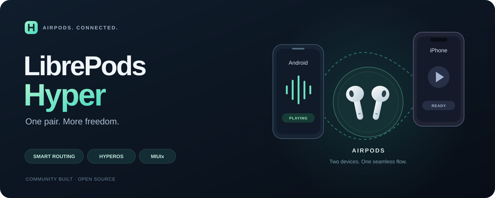

<p align="center"></p>

# LibrePods Hyper

**One pair. More freedom.** An Android AirPods companion focused on smart routing, Xiaomi HyperOS integration and a MIUIx interface.

[简体中文](./README.md) · [Installation](./android/README.md) · [Builds](https://github.com/Wtrwx/librepods-hyper/actions/workflows/ci-android.yml) · [Issues](https://github.com/Wtrwx/librepods-hyper/issues)

LibrePods Hyper is an independently maintained [LibrePods](https://github.com/librepods-org/librepods) fork by [Wtrwx](https://github.com/Wtrwx). Use this repository for Hyper builds and bug reports.

## Features

| Area | Implementation |
| --- | --- |
| Smart routing | AACP / TiPi audio ownership between Android and a second host, playback-triggered takeover and pausing Android when the remote host takes over |
| Connection order | Connection priority list initialization and relay announcements after the peer reaches Connected |
| HyperOS integration | Xiaomi Bluetooth compatibility, precise earbud / case battery values and preservation of system device metadata |
| Everyday controls | Listening modes, ear detection, battery notifications, Quick Settings and a home-screen widget |
| Interface | MIUIx theme and primary controls, light / dark appearance, with Apple and Material 3 alternatives |
| Device settings | Upstream head gestures, conversational awareness and accessibility controls, depending on the AirPods model and firmware |

Two-host connectivity depends on earbud firmware, the Android Bluetooth stack and the hook environment. Call-priority guards are implemented; test the calling applications you use separately.

The main test combination is **Xiaomi 17 / HyperOS (Android 16), iPhone XR / iOS 16.0 and AirPods Pro 3**. Existing Mac support comes from earlier work. Other combinations require their own validation. The inherited [Linux implementation](./linux/README.md) remains in this repository; Hyper's MIUIx and Xiaomi changes target Android.

## Getting started

1. Download a build from [Releases](https://github.com/Wtrwx/librepods-hyper/releases) or [Android CI](https://github.com/Wtrwx/librepods-hyper/actions/workflows/ci-android.yml).
2. Install the FOSS APK and grant the required permissions.
3. Enable the module in a compatible Xposed framework when your Bluetooth stack needs the workaround, or when using the vendor identity and Xiaomi integrations.
4. For smart routing, enable **Act as an Apple device**, **Allow automatic Smart Routing takeover**, and the AirPods **Automatic Connection** setting. Reload Bluetooth when prompted and reconnect.

See the [Android guide](./android/README.md) for Xposed module scope and troubleshooting. Installing the APK alone does not enable Xposed or grant privileged permissions.

Pair both hosts with AirPods. Routing coordination uses the earbud's Bluetooth control channel; Android and iPhone do not need IP connectivity, Tailscale or an iPhone companion app.

Validate Android-first / iPhone-second connection, playback switching in both directions and pausing the previous host, then repeat with the opposite connection order.

## Build

Use JDK 21, Android SDK 37, NDK 30.0.14904198 and CMake 3.22.1:

```sh
cd android
./gradlew :app:testFossDebugUnitTest :app:assembleFossDebug
```

The APK is generated at `android/app/build/outputs/apk/foss/debug/app-foss-debug.apk`. Configure release signing in an untracked `android/local.properties`. In-place updates require a matching signing key.

## Credits and license

Thanks to [LibrePods](https://github.com/librepods-org/librepods), [kavishdevar](https://github.com/kavishdevar), its contributors and protocol researchers. See the [Chinese README](./README.md#来源与许可) for additional acknowledgements and [apple-wireshark](https://github.com/pabloaul/apple-wireshark) for protocol tooling. The interface uses [MIUIx](https://github.com/compose-miuix-ui/miuix) and includes work based on Kyant0's open-source components. Hyper development, reverse engineering and testing also use AI assistance.

Copyright (C) 2025 LibrePods contributors. Existing copyright and license notices remain in the source files. Distributed under [GPL-3.0-or-later](./LICENSE).

LibrePods branding belongs to the upstream project. This community fork does not represent an official upstream release. AirPods, AirPods Pro and AirPods Max are Apple Inc. trademarks. This project is not affiliated with or endorsed by Apple or Xiaomi.
