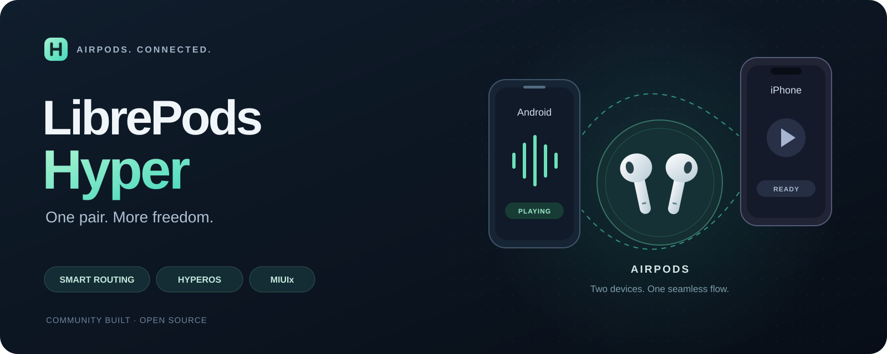

<p align="center">
  
</p>

<p align="center"><strong>一副 AirPods，连接更多日常。</strong><br />面向 Android 的 AirPods 增强客户端，专注智能切换、HyperOS 系统集成与 MIUIx 界面。</p>

<p align="center">
  <a href="https://github.com/Wtrwx/librepods-hyper/actions/workflows/ci-android.yml"></a>
  <a href="https://github.com/Wtrwx/librepods-hyper/releases"></a>
  <a href="./LICENSE"></a>
  <a href="https://github.com/compose-miuix-ui/miuix"></a>
</p>

<p align="center">简体中文 · <a href="./README.en.md">English</a> · <a href="./android/README.md">安装与设置</a> · <a href="https://github.com/Wtrwx/librepods-hyper/issues">反馈问题</a></p>

## 关于 Hyper

**LibrePods Hyper** 是由 [Wtrwx](https://github.com/Wtrwx) 独立维护的 [LibrePods](https://github.com/librepods-org/librepods) 衍生项目。它延续上游的 AirPods 协议支持，重点完善 Android 与 Apple 设备之间的音频协同，以及小米 HyperOS 的电量、设备信息和连接体验。

本分支与上游官方发行版分别维护。下载、构建和问题反馈请使用本仓库入口。

## 当前功能

| 能力 | 当前实现 |
| --- | --- |
| 多设备音频切换 | 通过 AACP / TiPi 协调 Android 与另一台设备的音频所有权；支持播放触发切换与远端接管时暂停本机媒体 |
| 连接顺序处理 | 初始化连接优先级名单，并在对端连接就绪后发送中继消息，修复先连 Android、后连 iPhone 的相关路径 |
| HyperOS 系统集成 | 小米蓝牙扩展兼容、左右耳与充电盒精确电量、系统设备元数据保留 |
| 日常控制 | 降噪、通透、自适应模式、入耳检测、电量通知、快捷设置与桌面小组件 |
| 连接提示 | 可配置底部弹窗与灵动岛样式提示 |
| MIUIx 外观 | MIUIx 主题与主要界面控件，提供浅色 / 深色适配；可切换 Apple 或 Material 3 外观 |
| 辅助与设备设置 | 延续上游的头部手势、对话感知、个性化设置及部分辅助听力功能，具体取决于机型与固件 |

多设备连接最多支持两台主机，实际可用性取决于 AirPods 固件、Android 蓝牙栈与 Hook 环境。通话优先级保护已经接入路由逻辑，仍需按具体通话应用验证。

### 验证范围

当前主要测试组合为 **小米 17 / HyperOS（Android 16）+ iPhone XR / iOS 16.0 + AirPods Pro 3**。Mac 相关适配来自此前的开发工作；不同耳机、手机系统与固件需要分别验证。

本仓库也保留了上游 [Linux 实现](./linux/README.md)。Hyper 新增的 MIUIx 界面与小米适配面向 Android。

## 安装

1. 从本仓库的 [Releases](https://github.com/Wtrwx/librepods-hyper/releases) 或 [Android CI](https://github.com/Wtrwx/librepods-hyper/actions/workflows/ci-android.yml) 下载构建产物。CI 提供 FOSS 调试 APK 和可选的 root 模块。
2. 安装 APK，授予蓝牙、通知及需要使用的其他权限。
3. 若系统无法原生建立 AirPods 控制通道，或需要多设备身份与小米集成，安装 root / Xposed 环境，并在 LSPosed / Vector 中启用模块与对应作用域。
4. 多设备使用时，在 App 设置中开启「模拟 Apple 设备」和「允许 Smart Routing 自动切换」，并启用耳机的「自动连接」。按提示重启蓝牙进程后重新连接。

完整作用域、可选系统模块与故障排查见 [Android 安装指南](./android/README.md)。仅安装 APK 不会自动赋予系统权限或启用 Xposed。

## 多设备切换

两台主机分别与 AirPods 配对。播放时，LibrePods Hyper 使用耳机的蓝牙控制通道协调音频路由，远端取得所有权后暂停 Android 媒体；Android 上新的播放动作可再次申请路由。

这套协同不要求 Android 与 iPhone 通过 Wi-Fi、IP 或 Tailscale 互通，也无需在 iPhone 上安装配套 App。

首次设置后，可按以下顺序确认自己的设备组合：

1. 两端暂停，先连接 Android，再连接 iPhone，确认 Android 仍保持连接。
2. 在 Android 播放，再在 iPhone 播放，确认音频切换及 Android 暂停。
3. 返回 Android 重新播放，确认能自动接回；再测试反向连接顺序。

## 构建

工程使用 **JDK 21、Android SDK 37、NDK 30.0.14904198、CMake 3.22.1**。在 Android Studio 中打开 `android/`，或运行：

```sh
cd android
./gradlew :app:testFossDebugUnitTest :app:assembleFossDebug
```

APK 输出到 `android/app/build/outputs/apk/foss/debug/app-foss-debug.apk`。构建可选系统模块：

```sh
./gradlew :app:zipDebugModule
```

模块输出到 `android/app/build/outputs/rootModuleZips/`。发行签名通过未提交的 `android/local.properties` 配置；同一签名的构建才能直接覆盖升级。

## 协议与贡献

- [AACP 操作码](./docs/opcodes.md)、[控制命令](./docs/control_commands.md)、[设备信息](./docs/device-info.md)
- [MIUIx](https://github.com/compose-miuix-ui/miuix)：Compose 界面组件库
- [apple-wireshark](https://github.com/pabloaul/apple-wireshark)：Apple 蓝牙协议解析工具

反馈连接问题时，请附上耳机型号与固件、手机型号与系统、root / Xposed 环境、连接顺序及复现步骤。日志中的配对密钥、个人设备地址等信息应先脱敏。

## 来源与许可

感谢 LibrePods 上游维护者 [kavishdevar](https://github.com/kavishdevar)、[librepods-org](https://github.com/librepods-org) 及所有贡献者，以及 [tyalie](https://github.com/tyalie)、[pabloaul](https://github.com/pabloaul)、[rithvikvibhu](https://github.com/rithvikvibhu)、[devnoname120](https://github.com/devnoname120)、[timgromeyer](https://github.com/timgromeyer) 的协议研究与实现工作。部分界面实现来自 [Kyant0](https://github.com/Kyant0) 的开源项目；依赖许可见应用内的开源许可页面。Hyper 的开发、逆向和测试也使用了 AI 辅助。

Copyright (C) 2025 LibrePods contributors. Hyper 的新增修改由相应贡献者维护。本项目继续采用 **GPL-3.0-or-later**，完整条款见 [LICENSE](./LICENSE)，保留源文件中的版权与许可声明。

LibrePods 名称、Logo 与品牌权利属于上游项目；LibrePods Hyper 由社区独立维护，不代表上游官方。AirPods、AirPods Pro、AirPods Max 为 Apple Inc. 的商标；本项目不隶属于 Apple 或 Xiaomi，也未获得其背书。
